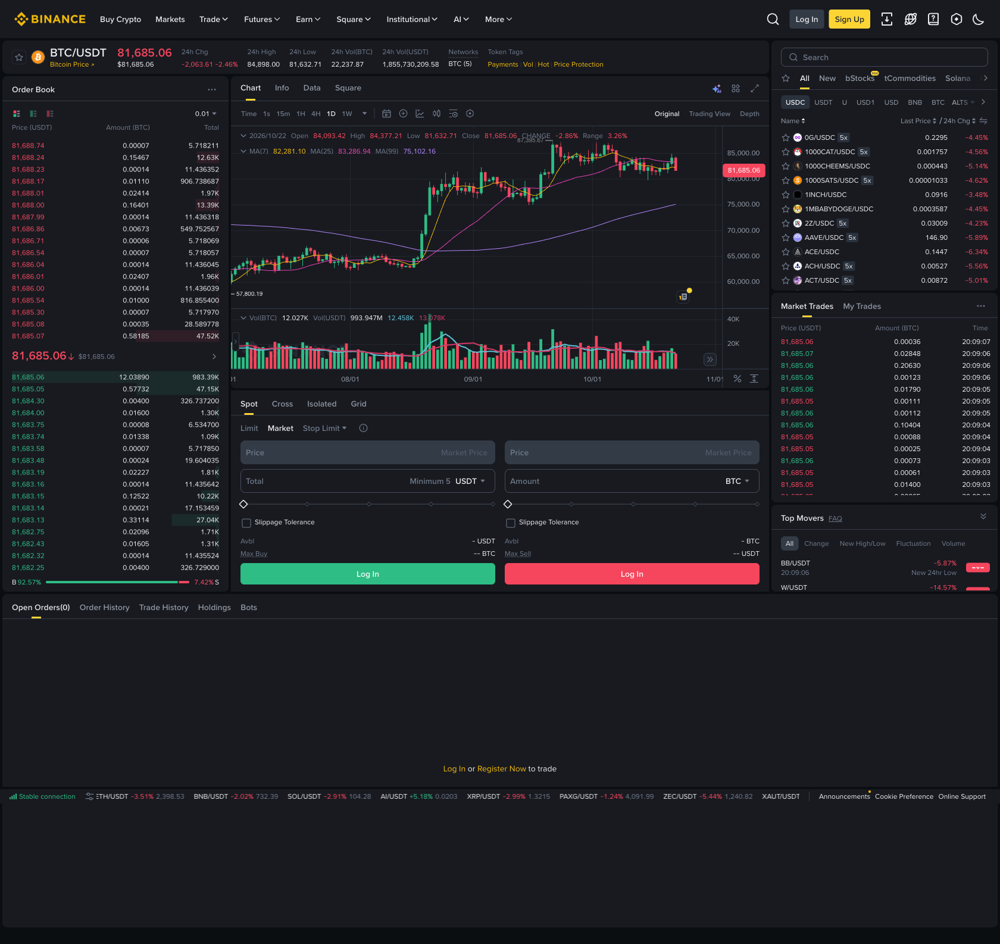
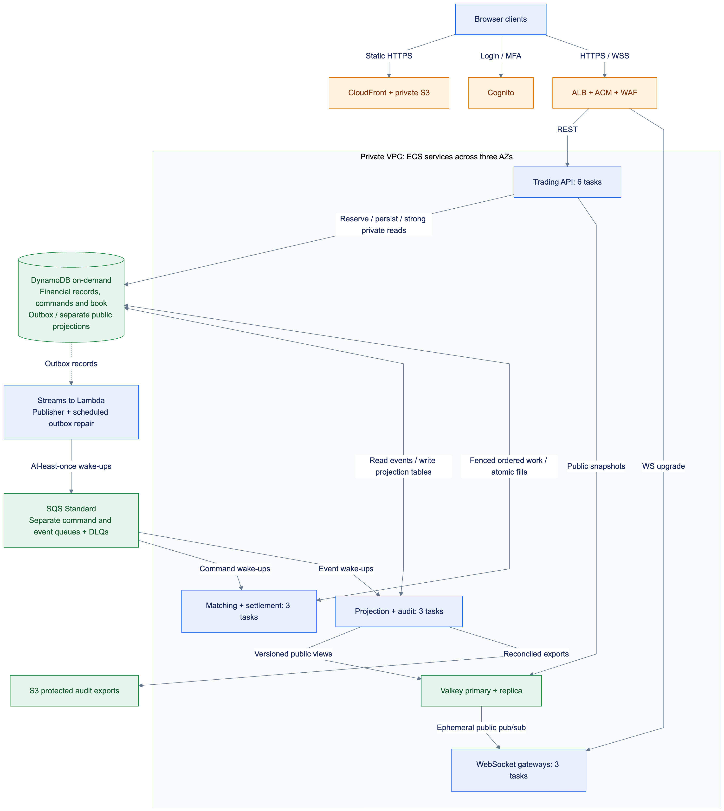
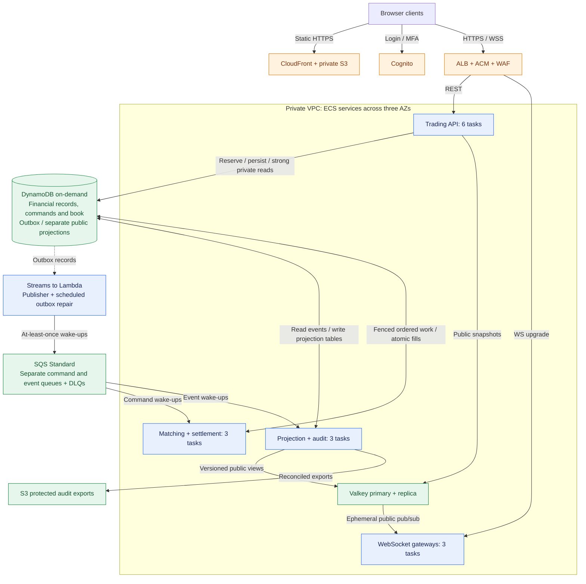
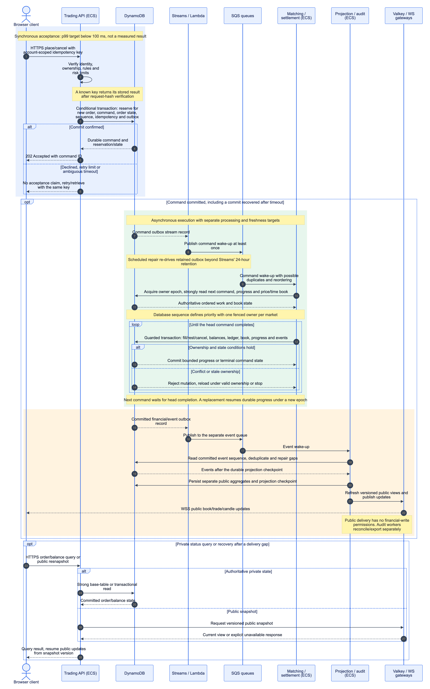

# Problem 1 — Building Castle in the Cloud

**Decision:** use **ECS Fargate**, **DynamoDB on-demand**, **SQS** and **managed Valkey**. DynamoDB fits the selected keyed financial records and offers managed throughput growth beyond 500 RPS; conditional transactions protect reservations and fills. SQS separates durable acceptance from processing; public delivery scales independently.

This is a recommendation based on verified capabilities and declared assumptions. Application latency and sizing still require validation.

## 1. Selected spot-trading features

[Binance BTC/USDT](https://www.binance.com/en/trade/BTC_USDT?type=spot) establishes feature scope.

| UI component | Role |
| --- | --- |
| Trading page | Browser application. |
| Summary / market list | Prices, daily statistics, pair search and favorites. |
| Order book | Aggregated bids/asks and liquidity. |
| Chart | Historical/live price and volume candles. |
| Order entry | Limit/market buy/sell commands and available funds. |
| Recent trades | Public executions. |
| Account tabs | Open orders, cancellation, history, fills and balances. |

**Scope:** ten spot markets and pre-funded accounts. Exclude margin/derivatives, stop orders, custody/transfers, fiat and compliance implementation.

## 2. Requirements and workload assumptions

| Requirement | Target |
| --- | --- |
| Cloud provider | **Amazon Web Services (AWS)** |
| Throughput | **500 requests per second** |
| Response time | **p99 <100 ms** |

| Peak HTTP workload | RPS |
| --- | ---: |
| Public snapshots | 250 |
| Place/cancel commands | 100 |
| Private orders/history/balances | 100 |
| Trading rules / local session checks | 40 |
| WebSocket upgrades | 10 |
| **Total** | **500** |

Assume **1,000 WebSockets / 5,000 batched outbound updates/s**, separate from HTTP RPS. Measure responses from nearby clients over warm connections.

**Response contract:** `202` follows durable reservation/order/command commit; matching and cancellation complete asynchronously. Interpret 100 ms as synchronous response latency. Cold setup, interactive MFA, processing and feed freshness need separate targets; a completed-execution interpretation requires reassessment.

## 3. Components behind the UI

| Component | Responsibility |
| --- | --- |
| Trading API | Verify ownership/rules, reserve funds, persist commands and serve queries. |
| Matching/settlement workers | Process each market in sequence; match a durable price/time book and atomically apply fills. |
| Outbox delivery | Streams/Lambda publishes wake-ups; scheduled repair re-drives retained pending records. |
| Projection/audit workers | Persist candle/history aggregates in separate projection tables, cache public views, export/reconcile financial events. |
| WebSocket gateways / Valkey | Deliver public snapshots/updates with gap recovery; never authorize spending. |
| DynamoDB | Authoritative balances, orders, book, command progress, idempotency and outbox. |

## 4. AWS architecture and logic flow

[Architecture Mermaid source](01.diagram/01.aws-architecture.mmd) · [Architecture SVG](01.diagram/01.aws-architecture.svg)

### Order flow

[Logic-flow Mermaid source](01.diagram/02.logic-flow.mmd) · [Logic-flow SVG](01.diagram/02.logic-flow.svg)

1. Validate identity, ownership, integer price/quantity, risk limits and account-scoped idempotency.
2. One DynamoDB transaction reserves funds and writes order, command, idempotency result, outbox and market sequence. Return `202` after commit; retry ambiguous timeouts with the same key.
3. Lambda sends SQS wake-ups. Workers fetch contiguous database commands; neither Streams nor SQS arrival order defines trading priority.
4. A fenced market owner queries a strongly consistent base-table price/time book. Conditional transactions guard ownership/progress, quantities, balances and unique fill IDs; update both parties, ledger and outbox together.
5. Complete or persist progress for the head command before advancing. Cancellation releases only the remainder after earlier fills settle.
6. Projectors catch up by committed event sequence and persist public aggregates separately. Clients resnapshot after pub/sub gaps. Financial reads use base tables/transactional reads; history indexes may lag.

Retain outbox records beyond Streams' 24-hour retention. Bound backlog, alert on DLQs/conflicts and pause unsafe admission. [Financial processing details](../../interview-coaching/problem1/02.financial-processing.md).

## 5. Why these AWS services?

| Choice | Why selected | Alternative / trade-off |
| --- | --- | --- |
| Route 53; S3/CloudFront OAC | DNS, cached SPA, private origin | Amplify simplifies hosting. |
| ALB/ACM/WAF | TLS, REST/WS routing, health and HTTP filtering | NLB lacks L7 routing; application controls protect WS messages. |
| ECS Fargate | Containers without host/cluster administration | EKS for Kubernetes requirements; ECS/EC2 for economical steady compute with host ownership. |
| **DynamoDB on-demand** | Key/range access, conditional transactions, managed AZ replication and throughput scaling | **RDS PostgreSQL** offers SQL joins/constraints and may cost less for steady writes; its proposed instance has one writer. |
| Streams/Lambda + SQS | Managed outbox delivery, buffering, retries and separate command/event queues | FIFO if broker ordering is required; MSK when retained log replay justifies operations/cost. |
| ElastiCache Valkey | Managed snapshots/pub-sub; disposable public data | Local caches diverge; a dedicated broker adds operations. |
| Cognito; IAM/KMS/Secrets Manager | Login/MFA, scoped task identities, encryption and runtime secrets | Self-hosted identity/vault adds maintenance; AWS-managed keys reduce cost/control. |
| CloudWatch/OpenTelemetry; S3 | Endpoint/queue/data metrics, traces, protected audit and PITR/export recovery | Self-hosted telemetry adds storage/operator work. |

**Database judgment:** 500 RPS alone does not select the database. The chosen key/range access model and burst-growth priority favor DynamoDB here. Accept explicit item/index design, transaction charges and hot-key limits; SQL flexibility or a measured steady-load cost advantage would favor PostgreSQL. [Decision evidence and alternatives](../../interview-coaching/problem1/01.database-and-scaling-verification.md).

Use private tasks/cache, TLS, security-group allowlists, private AWS endpoints and controlled egress. Public delivery has no financial-write permissions.

## 6. Availability and the 100 ms target

- Six API tasks, three trading workers, three projection workers and three WS gateways across three AZs.
- DynamoDB managed AZ replication; Valkey primary/replica with failover. Workers recover from durable command/book/progress records rather than local memory.
- Prepare initial table/index warm throughput for the full peak workload, including transaction and index amplification.
- Conditional ownership/progress rejects stale workers. Durable idempotency, reconciliation, PITR and verified restores protect recovery; regional recovery retains an agreed loss window.

| Acceptance-path allocation | Budget |
| --- | ---: |
| Nearby network / ALB | 15 ms |
| Local authentication / validation | 10 ms |
| DynamoDB transaction and bounded retries | 40 ms |
| Application overhead | 10 ms |
| Contingency | 20 ms |
| **Engineering target** | **95 ms** |

These are allocations, not measured percentiles. Processing and freshness have separate budgets; stream polling/queues are outside the acceptance path. A resting order may remain open.

**Validation:** 500 RPS/30 minutes at per-endpoint p99 <100 ms, counting in-profile errors as failures. Exercise duplicates, hot accounts/markets, stale owners, worker/AZ loss, cache failover, reconnects and reconciled restore.

## 7. Cost estimation

Assume `us-east-1`, 730 compute hours, 150 average HTTP RPS. Continuous WS: 5,000 ×300 bytes ≈**3.9 TB/30 days**, plus 1 TB HTTP/static traffic. Cost scenarios assume 30 commands/s and 30 fills/s; they are not measured demand.

| Item | Monthly planning allowance |
| --- | ---: |
| Fargate: 15 tasks, 9 vCPU / 18 GiB | $260–450 |
| DynamoDB: transactions, reads/indexes, storage/PITR | $2,500–4,000 |
| Valkey: small primary + replica | $60–150 |
| Command/event SQS queues and DLQs | $50–250 |
| ALB/VPC: LCUs, endpoints, NAT/internal transfer | $250–500 |
| S3, identity, ECR, telemetry, keys/secrets | $100–300 |
| Lambda delivery / scheduled repair | $20–100 |
| Approximately 5 TB data delivery | $400–700 |
| **Rounded budget with contingency** | **$3.7k–6.8k/month** |

Per-task candidates: trading workers **1 vCPU/2 GiB**; others **0.5 vCPU/1 GiB**. Illustrative ≤1-KiB item writes: six/command and sixteen/fill, with transactional factor two, produce **1,320 WRU/s**. At $0.625/million WRU, financial writes alone are **$2,138/30 days**, before projections/indexes/retries/storage. [DynamoDB pricing](https://aws.amazon.com/dynamodb/pricing/).

Storage/retention and write amplification require schema measurements. Reprice if 500 RPS is sustained all month. Excludes staging, staffing/support, tax and warm regional DR; pre-warming may add event charges. Review licenses and reprice with [AWS Calculator](https://calculator.aws/). This is not a quote or evidence of savings over RDS.

## 8. Scaling plan

| Layer | Elastic growth / limit |
| --- | --- |
| API | **6–30 tasks**, CPU target 60% / ALB requests per target; tune from measurements. Pre-scale a candidate floor of **12** before events; verify quotas/IPs and healthy targets. |
| Financial processing | **3–10 worker tasks** as independent markets need capacity. Scale by pending age/CPU; one market remains ordered, and hot balances/counters can bottleneck. |
| Public delivery | Projection **3–12**, WS **3–9** by backlog/connections/bytes; drain before scale-in. Resize/shard cache before known peaks. |
| DynamoDB | On-demand growth; verify table/index warm throughput, quotas and key distribution. Pre-warm ahead of events; more tasks cannot repair a hot key. |
| Vertical / sustained growth | Profile larger task revisions; raise service limits after validation. Consider ECS/EC2 for steady workers and an in-memory matcher/log only when measured bottlenecks justify migration. |
| Regional growth | Regional public views; one financial owner/domain with fenced, reconciled disaster recovery. |

Test **500 → 1,000 → 2,000 RPS spikes**, then explore **5,000 RPS** with the same mix. Report transition latency, errors, pending age, conflicts and cost. These are validation stages, not promised capacity.

**Validation performed:** Mermaid rendered to PNG/SVG; local links, diagram/source agreement and cost arithmetic checked. This is an architecture recommendation; sizing, p99, correctness, failure recovery and actual cost remain unmeasured. [Original task](problem1.md).
