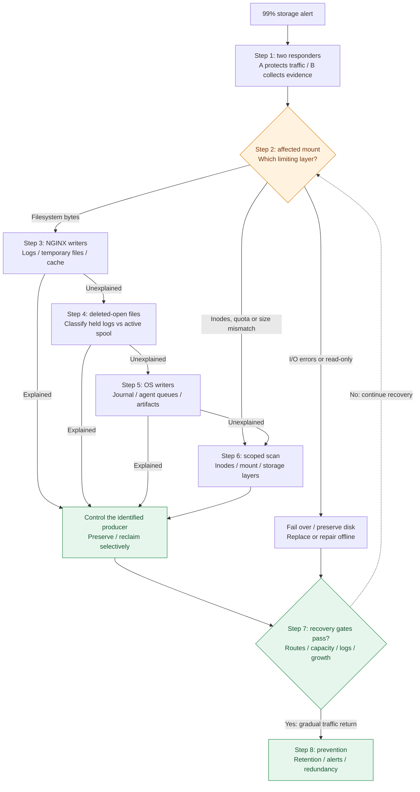

# Problem 2 — Diagnose Me Doctor

## Scope

- **Given:** Ubuntu 24.04, nominal 64-GB storage, NGINX as the only application, and a persistent 99% storage alert.
- This is a **troubleshooting proposal**; no host evidence establishes the cause. The brief mentions two issues but supplies one scenario.
- Check NGINX's writers first, then OS writers, then scan the affected filesystem if allocation remains unexplained.
- Assume HTTP proxying for temporary-file/cache checks; skip those branches for stream-only routing. Confirm actual paths, service unit and filesystem before using examples.

## Troubleshooting flow



[Mermaid source](01.diagram/01.troubleshooting-flow.mmd) · [PNG](01.diagram/01.troubleshooting-flow.png) · [SVG](01.diagram/01.troubleshooting-flow.svg)

## Step 1: Protect traffic and establish impact

| Responder | Responsibility |
| --- | --- |
| A — Traffic/incident | Check external errors/latency and upstream health. Validate replacement capacity, TLS and routing; coordinate cutover. |
| B — Investigation | Collect brief, read-only evidence and recent changes if accessible; keep a shared timeline and preserve the affected VM/disk. |

**Failed router:** stop sending it new traffic while restoring capacity. **Still serving:** prepare/validate a healthy peer or replacement, then drain. A sole router may remain an outage until replacement is ready. If inaccessible, use console/external telemetry and rescue access after traffic recovery. Evidence collection must not delay cutover.

```sh
systemctl status nginx.service --no-pager
sudo journalctl -u nginx.service --since '-30 minutes' -n 80 --no-pager
```

Probe representative service routes with the correct Host/TLS name and expected status, externally and locally. Correlate 5xx, timeouts, latency and disk growth. Avoid a blind restart of the sole router.

## Step 2: Identify what is actually full

```sh
date -u
df -hT
df -i
lsblk -o NAME,SIZE,TYPE,FSTYPE,MOUNTPOINTS
findmnt
sudo journalctl -k --since '-30 minutes' -n 80 --no-pager
```

**Check:** affected writable mount, available bytes, inode exhaustion, read-only/I/O errors and the device → partition → filesystem mapping. An inode shortage prevents file creation despite free bytes. Check `EDQUOT` separately from `ENOSPC`; exclude stale alerts and immutable loop mounts. Disk size alone does not prove filesystem capacity.

## Step 3: Attribute NGINX disk growth

**Goal:** locate the writer and correlate growth with traffic, upstream errors or a configuration change.

```sh
systemctl show nginx.service -p MainPID -p ExecStart
sudo nginx -T
sudo nginx -V
systemctl status logrotate.timer logrotate.service --no-pager
sudo logrotate --debug /etc/logrotate.conf
# Example only after confirming this is the configured log path:
sudo du -xhd1 /var/log/nginx
```

Use the binary/configuration from `ExecStart`. `-T` reads files currently on disk; compare with the last successful reload. `-V` exposes compiled defaults. Measure configured temporary/cache paths similarly. Logrotate's [debug mode](https://github.com/logrotate/logrotate/blob/main/logrotate.8.in) makes no rotation/state changes.

| Possible cause / evidence | Impact | Recovery |
| --- | --- | --- |
| **Logs:** large access/error files, failed rotation, debug logging or repeated upstream/bot errors | Lost observability; root fills and other writes fail | Offload closed archives, confirm receipt, then reclaim them; control the message source and repair rotation/reopening. Ensure creation/compression headroom first. |
| **HTTP temporary files:** large uploads/responses, slow clients or retained request bodies; inspect `client_body_temp_path`, `client_body_in_file_only`, `proxy_temp_path` | Uploads or proxied responses fail/incomplete | Drain affected requests; remove only verified abandoned files; bound body size, concurrency, timeouts and spool demand. |
| **Cache/store:** configured cache paths or `proxy_store` explain growth; missing/excessive retention | Root/inodes fill; cache purge can overload upstreams | Bound cache `max_size`, `inactive`, `min_free`; stop unintended storage; reclaim verified disposable objects after draining. |

[Request-body settings](https://nginx.org/en/docs/http/ngx_http_core_module.html#client_body_temp_path) and [proxy storage settings](https://nginx.org/en/docs/http/ngx_http_proxy_module.html#proxy_cache_path) distinguish these writers. Per-response temporary limits do not bound aggregate concurrency or cached/stored responses; cache eviction is asynchronous.

## Step 4: Check deleted files still held open

```sh
sudo lsof -nP +L1
```

**Evidence:** large unlinked files on the affected device explain space that directory scans miss. Match device/inode and owning processes; do not count duplicate descriptors as separate files. [lsof selection](https://lsof.readthedocs.io/en/latest/manpage/).

**Recovery:** a deleted log retains blocks until its last holder closes it. For a **confirmed NGINX log**, verify the master PID, replacement-path permissions and creation headroom, then:

```sh
sudo systemctl kill --kill-whom=main --signal=USR1 nginx.service
```

NGINX's [USR1 log reopening](https://nginx.org/en/docs/control.html#logs) avoids a service restart. Verify new log writes, remaining holders and reclaimed bytes. Active unlinked proxy spool files require draining; reopening logs does not release them.

## Step 5: Check Ubuntu and observability writers

```sh
sudo journalctl --disk-usage
sudo du -xhd1 /var/log
sudo journalctl --since '-30 minutes' -n 80 --no-pager
```

**Check:** journal/syslog message storms, blocked agent delivery, crash dumps, package caches and abandoned temporary files. OS services still write data when NGINX is the only application. Inspect `/var/crash`, `/var/lib/systemd/coredump`, `/var/cache`, `/tmp` and `/var/tmp` only where present/relevant.

**Impact/recovery:** logging or monitoring can fail and exhaust root. Fix the producer/delivery first; preserve required history and useful dumps. For journals, rotate then vacuum approved archived history; [vacuuming excludes active files](https://www.freedesktop.org/software/systemd/man/255/journalctl.html#--vacuum-size=). Use package-aware cleanup and retain running/fallback kernels. Bound agent queues; unsent audit records require an explicit retention decision.

## Step 6: Investigate remaining allocation or storage faults

Only now scan the affected mount, with privileges and attention to errors/I/O cost. These examples assume `/`; substitute the mount identified in Step 2.

```sh
sudo du -xhd1 /
# If inodes are exhausted, descend into the branch with most entries:
sudo du -x --inodes -d1 /
```

| Evidence / cause | Impact | Recovery |
| --- | --- | --- |
| Many small cache/temp/queue files; exhausted inodes | New files, logs or temporary requests fail | Stop the producer; reclaim verified expired entries in controlled batches; cap object counts. |
| Size/mount mismatch or `EDQUOT` | Purchased capacity unavailable, or writer allocation denied | Snapshot/preserve first; correct the proven mount/quota or grow the actual partition/filesystem/LVM layers with matching tools. |
| Material `df`/privileged `du` gap after checking open files | Allocation remains unexplained | Check hidden data beneath mounts and filesystem-specific accounting from maintenance/rescue access. |
| Kernel I/O errors or read-only mount | Writes fail; possible corruption | Fail over, preserve disk, replace/recover storage; repair unmounted/offline. |
| Unexpected files, owners, services or jobs | Accidental data growth or possible compromise | Identify the creator. If compromise is suspected, isolate after cutover, preserve evidence, rotate exposed credentials and rebuild from a trusted image. |

## Step 7: Validate recovery and return traffic

```sh
df -hT
df -i
sudo nginx -t
systemctl is-active nginx.service
```

**Proposed recovery gate:** ≥15% and ≥8 GiB available, ≥10% free inodes, and enough runout time for responders. Verify representative public/upstream routes, new/remote log delivery, absence of unexplained held allocation and stable growth through a representative peak. Observe initially for 30–60 minutes and confirm the next retention run separately.

Return traffic gradually; monitor errors/latency and keep the healthy replacement available for rollback.

## Step 8: Prevent recurrence

| Control | Practical action |
| --- | --- |
| Bound writers | Time/size log rotation, compression and agreed retention; verify timer frequency and reopening. Size rules run only when logrotate runs. |
| Preserve visibility | Off-host logs with bounded local queues; explicit journal [capacity/free-space budgets](https://www.freedesktop.org/software/systemd/man/255/journald.conf.html#SystemMaxUse=). |
| Control spool/cache | Measured size/concurrency/timeout budgets, bounded cache and separate storage where justified. Disabling buffering trades disk pressure for memory/upstream load. |
| Alert early | Free bytes/inodes, growth/predicted runout, failed rotation/delivery, per-route HTTP errors/latency and external probes. Start with warning <20% free, critical <10% or <5 GiB; tune to response time. |
| Maintain recoverability | Two healthy router instances or a tested replacement path; rehearse drain, restore and rotation. Extra disk buys time; controlling growth prevents recurrence. |

**Documentation checks:** Mermaid rendered to PNG/SVG and visually reviewed; local links and inline/source agreement checked.

**Status:** proposed commands and recovery criteria. No production VM was inspected; no root cause, cleanup, configuration change or traffic cutover has been validated. [Original task](problem2.md).
