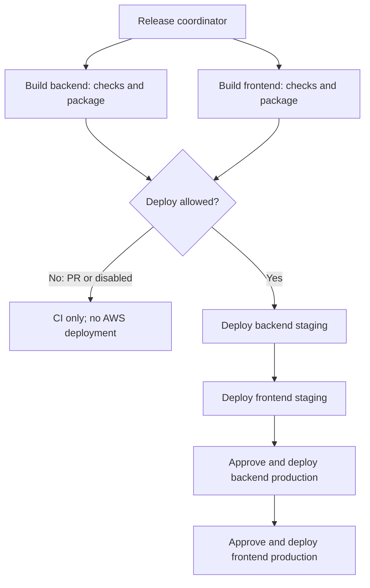

# Problem 4 — Ship It Twice

**Approach:** build once, verify in staging, promote identical packages to production with protected approvals, temporary AWS credentials, health checks and rollback.

## Assumptions

**Required by the [brief](problem4.md):** GitHub Actions for an HTTP backend on **EC2** and a static SPA on **S3**; no AWS account required for submission.

- **Apps:** `apps/backend` and `apps/frontend`, npm lockfiles and lint/test/build scripts. Node 24/Ubuntu 24.04 x86_64 aligns build/runtime dependencies. API: `dist/server.js`, port 3000, `/health/ready`, `/version` and runtime-secret-file support.
- **Configuration:** Vite-compatible SPA, relative `/api` and environment-specific runtime secrets/destinations enable promotion without rebuilding.
- **Availability:** isolated environments; ≥2 healthy EC2 targets plus rollout headroom. OneAtATime controls fleet cost and requires backward-compatible releases.

## Files and roles

| Files | Purpose |
| --- | --- |
| [problem4-release.yml](.github/workflows/problem4-release.yml) | Triggers, concurrency, build/deploy order and artifact handoff. |
| Backend [build](.github/workflows/problem4-build-backend.yml) / [deploy](.github/workflows/problem4-deploy-backend.yml) | Reusable backend CI and EC2 delivery jobs. |
| Frontend [build](.github/workflows/problem4-build-frontend.yml) / [deploy](.github/workflows/problem4-deploy-frontend.yml) | Reusable SPA CI and S3/CloudFront delivery jobs. |
| [scripts/](scripts/) | Packaging/checksums, release gates, AWS deployment and recovery. |
| [backend/](backend/) | CodeDeploy AppSpec/hooks, non-root systemd service and runtime secret retrieval. |
| [config/](config/) | IAM/OIDC, deployment alarms, host and CloudFront examples. |

## Required setup

1. Supply real applications. The nested workflows are **inactive**; activation requires root `.github/workflows/` and updated `tasks/problem4/...` references matching the support-file location.
2. Provision EC2/ALB/ASG, runtime tools, CodeDeploy agent, `shipit-backend` user/host configuration; versioned buckets; CloudFront/OAC, TLS, uncached `/api` routing and HTML minimum TTL zero.
3. Configure GitHub OIDC deployment roles, the CodeDeploy service role and EC2 artifact/secret access. Use four GitHub environments: `backend-staging`, `frontend-staging`, `backend-production`, `frontend-production`; restrict deployments to `main`, with production reviewers and no self-approval.
4. Set role/region/URL and bucket/group/distribution variables from each deploy workflow. Supply runtime secrets, deployment alarms and known-good production revisions for rollback.

## Pipeline design

Parallel builds feed the coordinator's **`needs:`** deployment chain. PRs build only; `main` deployment requires `PROBLEM4_DEPLOY_ENABLED=true`. Each production job needs approval. Failures block later stages; main releases are serialized.

## Backend pipeline

**CI — continuous integration and publication:** `npm ci` → lint → tests → high-severity dependency audit → build → production dependencies/SBOM → package/upload. Publish `bundle.tgz`, `release.json` and `SHA256SUMS`. Identity is **commit + run + attempt**; staging/production receive the same package. This demo uses an application archive for Node/systemd delivery.

**CD — deployment to EC2:** artifact/branch/environment checks → OIDC → versioned S3 revision → CodeDeploy OneAtATime. Targets drain; hooks install/start and gate readiness/exact commit before traffic returns. Public checks and release records follow.

**Backend rollback:** deployment/alarm failures use CodeDeploy rollback; failed public checks trigger prior-revision recovery. Hooks/readiness still run. Explicit recovery overrides deployment alarms; unconfirmed recovery requires an operator.

## Frontend pipeline

**CI:** same check/audit/build/SBOM gates; compile assets under `/releases/<release-id>/` and package once.

**CD:** verify/gate → OIDC → immutable assets → root `index.html` last. HTML revalidates; invalidate CloudFront and verify public index/sample-JavaScript hashes.

**Frontend rollback:** ownership checks → restore prior index version → invalidate → verify. Retain previous assets for open browsers/rollback; CDN convergence takes time.

## Deliberately left out

- AWS provisioning/IaC and application implementations: supplied separately before activation.
- Container/ECR delivery, blue/green fleets, schema migrations, browser journeys, signed attestations and artifact garbage collection: separate adoption work. Checksums provide integrity checking, not independent signing.
- An atomic backend/frontend release: frontend failure leaves the successful backend deployed; old/cached clients must remain compatible. A new `main` commit can stop promotion midway.

**Validation:** documentation/links and workflow-to-report consistency checked. No application build/test, GitHub run, AWS deployment or rollback was executed for this refactor. [Pipeline/AWS diagrams](01.diagrams/README.md) · [Task](problem4.md).
