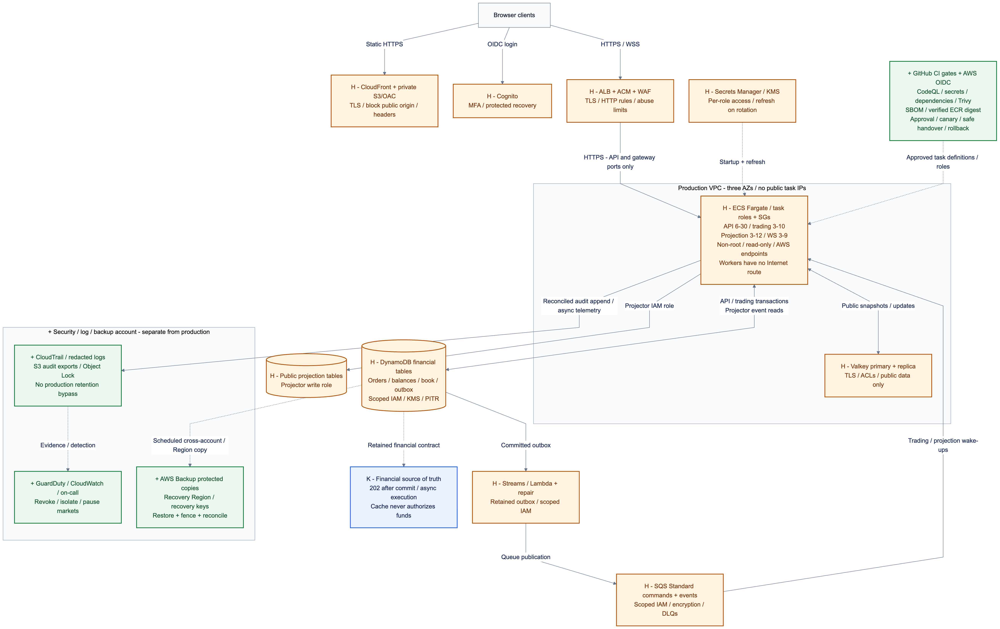

# Problem 5 — Fortify the Castle

**Decision:** harden the [Problem 1 architecture](../problem1/SOLUTION.md): ECS Fargate, DynamoDB, SQS and Valkey. Preserve **500 HTTP RPS / p99 <100 ms for durable acceptance**, three AZs and independent scaling. This is a proposed security design; no AWS resources or controls have been deployed.

## 1. Security priorities

1. **Protect accounts and funds:** prevent account takeover, unauthorized orders and duplicate settlement.
2. **Contain compromise:** restrict workload identities, network paths and production changes.
3. **Detect and recover:** retain trustworthy evidence and recover reconciled financial state.

Delayed public prices are tolerable; unexplained balances are not. Stop affected trading when financial integrity cannot be established.

## 2. Updated architecture, with security changes marked

[Mermaid source](01.diagram/01.security-architecture.mmd) · [Scalable SVG](01.diagram/01.security-architecture.svg)

**Legend:** **H / amber** = existing component hardened; **+ / green** = added control; **K / blue** = retained design. Solid arrows carry data; dotted arrows show controls, recovery or notes. The ECS box groups four independently deployed services. Regional services remain outside the VPC. DNS is omitted.

TLS, WAF, private tasks, OAC, IAM and encryption already appear in Problem 1. The changes below specify their enforcement and add release, detection and recovery controls.

## 3. Why each infrastructure change is there, and what it protects against

### Edge and network

- **H — Limit exposure:** HTTPS/WSS → ALB/ACM/regional WAF; CloudFront serves the SPA. Enforce TLS 1.2+, HSTS, private S3/OAC and Block Public Access. WAF protects HTTP endpoints, not DNS. Tune managed rules, endpoint limits and oversize rejection against legitimate bursts. [WAF limits](https://docs.aws.amazon.com/waf/latest/developerguide/waf-rule-statement-fields-list.html).
- **H — Restrict movement/exfiltration:** only ALB groups reach API/WS ports; workers have no inbound listeners. Restrict cache access to API/projectors/gateways. Scope DynamoDB/S3 gateway and SQS/ECR/Logs/Secrets Manager interface endpoints. Financial workers have no Internet route; API key refresh uses a controlled HTTPS proxy. NAT/SGs alone cannot enforce domain allowlists. [ECS networking](https://docs.aws.amazon.com/AmazonECS/latest/developerguide/security-network.html).
- **H — Encrypt internal paths:** HTTPS target groups, AWS SDK HTTPS and Valkey TLS/ACLs. ALB does not validate target certificates; security groups provide the target boundary, not mutual TLS. [ALB target TLS](https://docs.aws.amazon.com/elasticloadbalancing/latest/application/load-balancer-target-groups.html).

### AWS access and service isolation

- **+ — Separate production, nonproduction and security/log accounts.** Federation, MFA, temporary admin access and organization guardrails protect logs, backups and IAM changes.
- **H — One task role per service; separate execution roles for image pulls/log delivery.** Scope actions/resources; give Lambda its own outbox role. No static AWS keys. [Task roles](https://docs.aws.amazon.com/AmazonECS/latest/developerguide/task-iam-roles.html).

| Identity | Maximum intended application access |
| --- | --- |
| Trading API | Financial reads/reservation writes, commands/outbox; public-cache reads |
| Matching/settlement | Financial/book/progress transactions; command queue consumption |
| Projection/audit | Financial-event reads; separate public-table/cache writes; audit append |
| WebSocket gateway | Public-cache reads/subscriptions; **no financial-table access** |
| Publisher/repair Lambda | Outbox/stream reads and delivery markers; queue publication |

Endpoint policies supplement IAM. Restrict ECS financial access to approved endpoints without blocking Lambda/Streams integrations. **IAM cannot enforce balance arithmetic or user ownership**; compromised financial writers remain a serious risk. [Endpoint controls](https://docs.aws.amazon.com/vpc/latest/privatelink/vpc-endpoints-ddb.html).

### Containers

- **H — Reduce exploit impact:** non-root, read-only root with scratch storage, minimal capabilities, CPU/memory limits and health checks. Use a maintained minimal base; evaluate Wolfi for runtime/scanner compatibility. Rebuild for fixes; no base stays CVE-free. [ECS hardening](https://docs.aws.amazon.com/AmazonECS/latest/developerguide/security-tasks-containers.html).
- Keep ECS Exec disabled. Emergency debugging requires a separately approved, audited task revision: Exec requires a writable filesystem and runs commands as root. [Exec constraints](https://docs.aws.amazon.com/AmazonECS/latest/developerguide/ecs-exec.html).

### Data, keys, and secrets

- **H — Encryption policy:** DynamoDB encrypts at rest by default. Use customer-managed KMS keys for financial tables/audit/backups, separate recovery ownership and key-deletion alerts. Keep managed encryption for disposable data. Encryption cannot stop authorized misuse. [DynamoDB encryption](https://docs.aws.amazon.com/amazondynamodb/latest/developerguide/EncryptionAtRest.html).
- **H — Secrets Manager:** fetch per-service secrets at startup, cache in memory, refresh on rotation and redact logs. No repository/build/browser secrets or per-order lookup. Environment injection requires replacement tasks after rotation. [ECS secret rotation](https://docs.aws.amazon.com/AmazonECS/latest/developerguide/secrets-envvar-secrets-manager.html).

### Logs and alerts

- **+ — Independent evidence:** organization CloudTrail, selected financial-write/audit events, WAF/ALB and redacted application logs reach the security account. Versioned S3/Object Lock protects retained evidence; production cannot delete versions, bypass retention or administer its key. Separately controlled security administrators retain governance-mode bypass. [Object Lock](https://docs.aws.amazon.com/AmazonS3/latest/userguide/object-lock.html).
- **+ — Response:** GuardDuty/CloudWatch page an owner for credential misuse, IAM/key/log changes, authorization spikes, financial mismatches, endpoint 5xx/p99, queue age/DLQs and audit gaps. Runbooks cover revocation, isolation and market pauses. [GuardDuty](https://docs.aws.amazon.com/guardduty/latest/ug/what-is-guardduty.html).

### Build and deployment

- **+ — CI gates:** GitHub CodeQL SAST, secret scanning, dependency review, Trivy image/IaC scans and SBOMs. Scan changes and schedule rescans/rebuilds. Block exposed secrets and exploitable critical/high findings; exceptions need ownership/expiry. Native private-repository features may require licences. [Code scanning](https://docs.github.com/en/code-security/concepts/code-scanning/code-scanning).
- **+ — Delivery:** reviewed IaC plans, protected branches/environments, pinned action SHAs and isolated untrusted PR jobs. Scope GitHub AWS OIDC to actual repository/environment claims; separate build/deploy roles and constrain `iam:PassRole`. Verify signatures/provenance in the deployment gate; promote one ECR digest. ECS does not automatically enforce signatures. Canary API/WS releases, fence worker handovers and roll back to the previous task definition. [OIDC trust](https://docs.github.com/en/actions/how-tos/secure-your-work/security-harden-deployments/oidc-in-aws).

### Availability and recovery

- **K/H — Elastic capacity:** API **6–30**, trading **3–10**, projectors **3–12**, WS **3–9**; pre-scale events. Limit by account/IP, bound backlog and shed public updates before financial capacity. Verify JWTs locally; security logs stay asynchronous, while financial outbox records commit with acceptance.
- **+ — Survive deletion/ransomware:** retain PITR and add scheduled AWS Backup copies outside production/in a recovery Region, with protected retention and recovery keys. Test restore, common recovery points across financial tables, owner fencing and reconciliation before resuming writes. SQS is not the recovery journal; retained DynamoDB commands/outbox drive replay. [DynamoDB backup copies](https://docs.aws.amazon.com/aws-backup/latest/devguide/advanced-ddb-backup.html).

## 4. What I would refuse to ship without

- MFA for privileged access, tested account ownership checks and safe session recovery.
- Private workloads, reviewed IAM/egress, TLS, secret handling and protected audit evidence.
- Verified reservation/idempotency/fencing invariants, reconciled restore and an incident owner.
- Scanned, provenance-verified releases; independent application/security review before real funds.
- Evidence that security controls sustain 500 RPS/p99 <100 ms, plus abuse, AZ-loss and recovery exercises. These are **launch gates, not completed tests**.

## 5. What I deliberately left out, and the trade-offs I accepted

| Deferred / retained choice | Accepted risk and reason |
| --- | --- |
| Service mesh and dedicated Network Firewall | SGs, endpoints and the limited egress proxy cover current paths. Less uniform service identity/deep inspection; revisit with third-party integrations. |
| Shield Advanced and a full SIEM | Shield Standard, WAF and owned alerts first. Less incident assistance/correlation; reconsider against exposure and staffing. |
| Active-active financial writes | Keep one fenced owner per market. Regional recovery can interrupt trading and lose data within the agreed recovery window. |
| Public feeds and disposable Valkey | Scraping and temporary feed loss accepted; cache never authorizes spending. |

**Cost:** private interfaces across three AZs, KMS, scanners, data-event logs, retained backups and on-call work add to Problem 1's estimate. Price measured log volume/retention, scan coverage and CI licences before approval. No added security-cost total is claimed.

## 6. Missing facts and assumptions

| Missing fact / how to obtain it | Interim assumption |
| --- | --- |
| Scope, data inventory and retention: product/legal/data-owner review | Ten spot markets, pre-funded accounts; no custody/transfers, derivatives or compliance implementation. No compliance claim. |
| RTO/RPO and audit retention: business-impact review and restore drills | One financial Region; nonzero regional loss window. Do not approve launch until explicit objectives/retention are agreed. |
| Client geography, abuse and external dependencies: telemetry, threat modelling and integration inventory | Problem 1's 500 HTTP RPS, 1,000 WS connections and 5,000 batched updates/s; nearby warm connections. |
| CI entitlement and response capacity: repository/account review | GitHub Actions, named on-call owner; licence or equivalent tooling must be budgeted. |

## 7. Additional application changes

- **Identity:** Cognito OIDC/PKCE, MFA and protected recovery; validate signature, issuer, client/audience, token use, expiry and scopes. Check ownership on every private action. Short token lifetimes bound revocation lag; high-risk actions require fresh verification.
- **Browser/WS:** CSP, restricted CORS, frame protection and CSRF defence for cookie-authenticated actions. Validate WS origins, connection/message/subscription limits and slow clients. WAF inspects HTTP requests, so implement post-upgrade message validation in the gateway; keep this design's feed public-only. Never log tokens.
- **Trading:** strict schemas/integer units, account trading limits and request-bound idempotency. Preserve atomic reservation/fill/outbox commits, stale-owner rejection and reconciliation from Problem 1. Reject or pause when authorization or financial state is uncertain.

**Review status:** diagram rendered to PNG/SVG and local references checked. No deployment, penetration test, security scan, load test or recovery exercise was performed for this design. [Original task](problem5.md).
